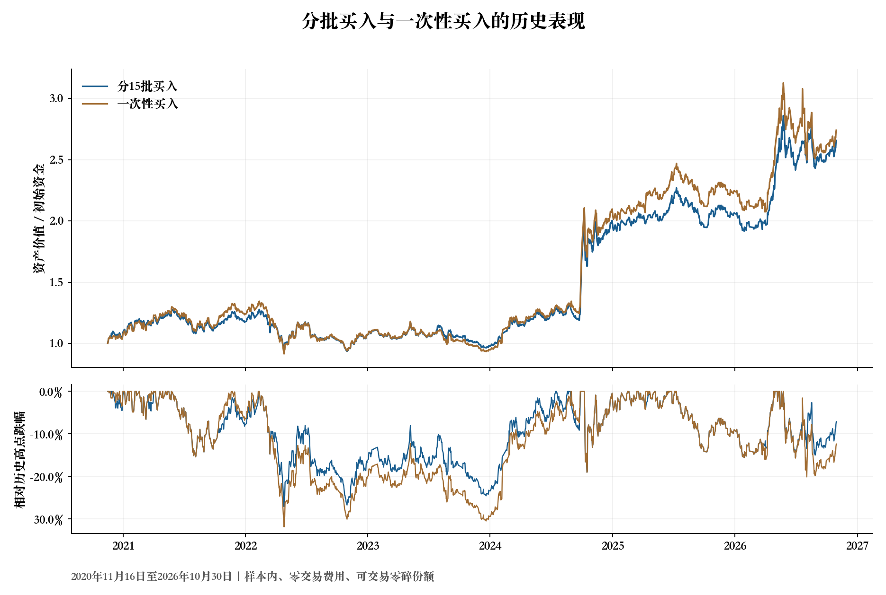
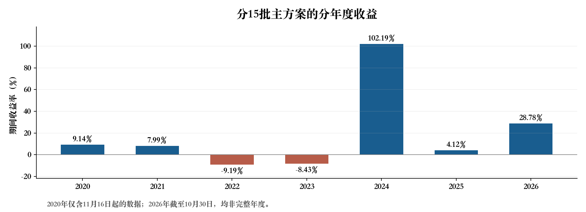

# 科创50与银行基金分批切换策略研究

围绕科创50指数的年度回撤统计与均线信号，研究科创50基金和银行基金之间的切换策略，比较分批买入、建仓期间退出安排及不同退出条件对收益和风险的影响。

本项目包含聚宽平台策略程序、六组本地历史模拟结果、指标复算程序及图表。下列业绩来自保存的本地模拟结果，并非聚宽平台导出的回测或真实交易业绩。

## 主要结果

主方案采用15批买入，并在建仓期间出现新的均线向下交叉时退出。历史模拟区间为2020年11月16日至2026年10月30日，共1,444个交易日，初始资金10万元。

| 指标 | 主方案结果 |
| --- | ---: |
| 累计收益率 | 165.67% |
| 年化收益率 | 17.84% |
| 夏普比率 | 0.81 |
| 最大回撤 | 27.13% |
| 期末资产 | 265,671.25元 |
| 科创50入场轮次 | 11轮 |

上述结果为样本内、零交易费用、零成交价偏差、可交易零碎份额的历史模拟。夏普比率使用每日简单收益、零无风险收益率和每年252个交易日计算。完整口径见下文。



在相同入场与均线交叉退出规则下，分15批买入较一次性买入将最大回撤从31.87%降至27.13%，减少约4.74个百分点；累计收益从174.10%降至165.67%，减少约8.42个百分点。该对照反映了这一历史区间内分批买入的收益与风险取舍。

## 策略设计

### 入场依据

比较科创50指数各年度的最大回撤，取其中最小值约17.98%作为研究阈值；这一数值对应2025年的约17.9842%。年度回撤依据每年年初以来的最高收盘价计算。阈值统计需要包含年初以来的历史行情，不能将2020年11月16日之后的短区间当作2020完整年度。

由于该阈值参考了包括回测期间在内的历史资料，本项目将结果标为样本内检验，尚未提供参数冻结后的独立时期验证。

### 买入与卖出

1. 初始持有银行基金512800。
2. 科创50指数000688较当年最高收盘价的跌幅，从不超过17.98%变为超过17.98%时，产生入场信号。
3. 从下一交易日开始，计划在15个交易日中分15批买入科创50基金588000，每批预算依据触发信号时的组合资产价值确定。
4. 不设置固定价格止损。持有期间，5日平均收盘价从不低于20日平均收盘价变为低于它时，触发退出信号；下一交易日卖出科创50基金，取消未完成批次，转回银行基金。
5. 其他时间持有银行基金；信号条件再次成立时可重新入场。

均线由科创50指数的收盘价计算，跨年连续计算；年度回撤高点每年重算。“新发生向下交叉”与“当前5日均线已经低于20日均线”是两种不同的退出条件，本研究分别进行了模拟。退出信号可能在盈利或亏损时触发，因此不将它表述为保证盈利的止盈规则。

## 六组规则对照

所有方案使用同一历史区间、相同数据来源及零交易费用假设。下表最大回撤按跌幅的正数表示。

| 方案 | 买入批次 | 建仓期间允许退出 | 退出条件 | 累计收益 | 年化收益 | 夏普比率 | 最大回撤 |
| --- | ---: | :---: | --- | ---: | ---: | ---: | ---: |
| 1 | 1 | 是 | 新发生向下交叉 | 174.10% | 18.46% | 0.80 | 31.87% |
| **2 主方案** | **15** | **是** | **新发生向下交叉** | **165.67%** | **17.84%** | **0.81** | **27.13%** |
| 3 | 15 | 否 | 新发生向下交叉 | 160.21% | 17.43% | 0.79 | 31.48% |
| 4 | 15 | 否 | 5日均线低于20日均线 | 112.08% | 13.46% | 0.78 | 36.76% |
| 5 | 15 | 是 | 5日均线低于20日均线 | 56.02% | 7.76% | 0.53 | 30.61% |
| 6 | 1 | 是 | 5日均线低于20日均线 | 46.51% | 6.63% | 0.47 | 32.17% |

“建仓期间允许退出”表示尚未完成计划批次时，仍可按退出条件卖出。主方案11轮入场中有10轮完成15批买入，另1轮在买入2批后退出。对照结果可在[指标汇总表](results/summary.csv)中查看。



2024年主方案收益约102.19%，而2022年、2023年为负，提示整体表现受到特定市场阶段的明显影响。2020年仅覆盖11月16日之后，2026年截至10月30日，图中两年均不是完整年度。

## 文件与复核方式

| 文件 | 内容 |
| --- | --- |
| [聚宽策略程序](strategy/joinquant_strategy.py) | 原策略代码，入场阈值17.98%，买入批数15 |
| [完整回测结果](results/backtest_results.json.gz) | 六组原始结果的无损压缩包，包含每日资产价值、交易记录、每轮买入及退出信息 |
| [指标汇总](results/summary.csv) | 六组规则及重新计算的收益、风险指标 |
| [主方案逐日结果](results/main_daily.csv) | 每日资产价值、两类基金市值与回撤 |
| [指标复算程序](scripts/analyze_results.py) | 读取压缩结果，重新计算指标并核对原文件中的累计收益和最大回撤 |
| [图表生成程序](scripts/plot_results.py) | 根据相同结果生成两张图表 |
| [原结果文件校验值](results/original_sha256.txt) | 核对解压后文件与原始结果是否一致 |

### 复算已保存的结果

下载仓库后，在仓库目录运行下列命令。指标复算只需要Python（编程语言）标准库，不需要聚宽账号，也不会发出交易指令。

```bash
python3 scripts/analyze_results.py
```

程序自动读取压缩结果，并生成指标汇总和主方案逐日结果。完整结果解压后为原始的“分批影响拆解结果.json”内容，使用JSON（JavaScript对象表示法）格式保存。

如需重新绘图，先安装matplotlib（绘图库），再运行绘图程序。中文显示需要系统具有中文字体，也可通过`--font`指定字体文件。

```bash
python3 -m pip install -r requirements.txt
python3 scripts/plot_results.py --font /path/to/chinese-font.ttf
```

### 在聚宽重新运行策略

将`strategy/joinquant_strategy.py`复制到聚宽策略编辑器，选择按天回测、初始资金100000元，以及账户行情可覆盖的起止日期。代码默认佣金和成交价偏差为零，可按需要修改。行情权限不足或数据缺失时，程序会报错而非沿用过期行情。

聚宽代码与本地模拟的执行约束不同：聚宽程序按100份整数倍买入，检查停牌、涨跌停和实际成交结果；本地结果允许零碎份额按开盘价成交。两者的最终收益可能不同。本仓库的复算程序用于核对已保存结果，不等同于从原始行情重新运行完整本地交易模拟；仓库未附原始行情文件。

## 指标口径与研究边界

- 累计收益：期末资产除以初始资金，再减1。
- 年化收益：按首末日期的实际天数除以365.25折算年数，再计算复合年化收益。
- 夏普比率：每日简单收益的均值除以样本标准差，再乘252的平方根；无风险收益率取零。首日收益相对初始资金计算。
- 最大回撤：逐日资产相对此前最高资产价值的最大跌幅，初始资金也纳入高点序列。
- 本地结果来源字段为腾讯行情。现有本地核算对银行基金2025年7月的份额拆分作了价格统一处理；相关数据清理与平台复权口径可能导致差异。
- 六组结果是规则对照，不是六段独立验证时期；目前也不能据此证明15批是最优批数，或策略优于长期持有两类基金。
- 后续可补充交易成本、整手成交、参数附近取值以及参数冻结后新时期的验证。
